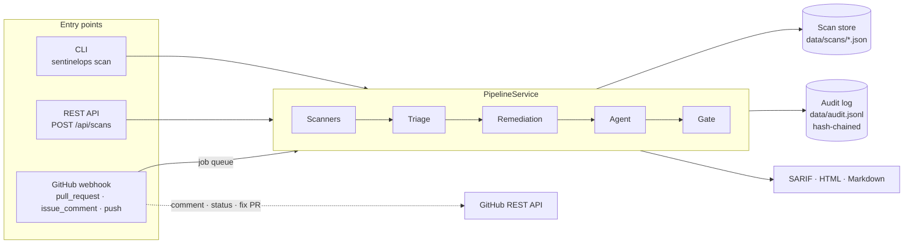

# Architecture

SentinelOps is one NestJS application with three front doors (CLI, HTTP API, GitHub webhook) and one pipeline behind them.



## The pipeline, step by step

| Step | Module | What happens |
|---|---|---|
| 1. Load | `scanners/files.ts` | Walk the tree (skipping `node_modules`, `.git`, build output, binaries, files > 1 MB). Each file gets a language tag. |
| 2. Scan | `scanners/*` | Built-in SAST, secrets, dependency and config scanners run in parallel, plus semgrep / gitleaks / trivy when installed. Every finding carries CWE ids, a stable fingerprint and a short id (`SO-1a2b3c4d`). |
| 3. Enrich & dedupe | `scanners.service.ts`, `knowledge/` | CWE ids map to OWASP Top 10 2021 categories; the same issue reported by two tools collapses into one finding that notes the other reporter. |
| 4. Triage | `triage/triage.service.ts` | Risk score 0-100 from severity × confidence, then explainable adjustments (request input reaches the sink, application path, dev-only dependency, test/example code). Priority P1-P4. Baseline entries suppress accepted findings until they expire. |
| 5. Remediate | `remediation/` | Deterministic fixers rewrite the code. Each proposal is **verified**: the edited file must parse and a re-scan must no longer report the finding without introducing a new one of equal or higher severity. |
| 6. Review | `agent/` | The agent (LLM tool loop or offline planner) inspects the top findings, records verdicts, picks fixes and writes a briefing, inside the autonomy policy and guardrails. |
| 7. Gate | `triage.gate()` | Pass/fail on the highest active severity (`--fail-on`, default `high`). Exit code 1 in CI. |
| 8. Report & store | `reports/`, `store/` | SARIF 2.1.0, a Markdown PR comment and a self-contained HTML report; the scan is stored for history and "introduced / fixed" diffs. |

## Data model

The unit of work is a `Finding` (`src/common/types.ts`):

```ts
{
  id: 'SO-333f18f3',              // short, stable id (from the fingerprint)
  fingerprint: 'sha256…',         // rule + file + normalised code: survives line moves
  ruleId: 'js.sqli.string-built-query',
  category: 'sast' | 'secret' | 'dependency' | 'config',
  severity, confidence, cwe: ['CWE-89'], owasp: ['A03:2021'],
  location: { file, line, snippet },
  package?: { name, version, fixedIn, advisory, direct, dev },   // dependencies
  risk: 100, priority: 'P1', triageNotes: ['+8 request input flows directly into the sink'],
  fix?: { strategy: 'rule' | 'dependency' | 'ai', diff, verified, verification },
  verdict?: { status: 'true_positive' | 'likely_false_positive' | 'needs_review', rationale, by, guardrail? },
}
```

## Module map

```
src/
  common/types.ts          Finding, FixProposal, ScanResult, Verdict
  config/                  environment -> AppConfig (global Nest module)
  knowledge/               OWASP Top 10 2021 + CWE catalogue, enrichment, heatmap
  scanners/
    files.ts               file walker, fingerprints, inline suppressions
    sast/                  26 rules (JS/TS, Python) + line engine with taint escalation
    secrets/               provider patterns, entropy filter, masking
    deps/                  manifests, version ranges, OSV.dev client, offline advisories
    config/                Dockerfile, compose, Kubernetes, GitHub Actions, .env
    external/              semgrep / gitleaks / trivy adapters
    scanners.service.ts    orchestration, cross-tool dedupe
  triage/                  risk, priority, baseline, gate, scan diff
  remediation/
    fixers/                deterministic fixers (injection, web, supply chain)
    diff.ts verify.ts      unified diffs, syntax check + re-scan verification
  agent/                   LLM client, tools, guard, policy, audit, agent loop
  reports/                 SARIF, Markdown, HTML
  pipeline/                PipelineService, AuditService, CoreModule
  store/                   file-backed scan history
  github/                  REST client, webhook handling, job queue
  api/                     REST controllers, token guard
  cli.ts main.ts           entry points
assets/                    report.html and dashboard.html templates
```

## Extending it

- **A SAST rule**: add an entry to `RULES` in `src/scanners/sast/rules.ts` (patterns, CWE, remediation). Add a test in `test/sast.spec.ts`. The CWE decides the OWASP category automatically.
- **A fixer**: write a `Fixer` (`(ctx) => { content, description } | null`), register it in `src/remediation/fixers/index.ts`, and set `fixer:` on the rule. Verification is automatic; add a test that the fixed code re-scans clean.
- **A scanner**: implement `Scanner { name; scan(ctx) }` and add it to `defaultScanners()`. Use `makeFinding()` so ids and fingerprints stay consistent.
- **Storage**: `ScanStore` has four methods (`save`, `get`, `list`, `previous`); swap in a database by providing a different implementation.
